<div align="center">

# DeepCraft

**Customizable branding, color palettes and typefaces for the DeepSeek Harness Web GUI.**

> **Ocean blue by default, with Warm ember and Forest green beside it; the mark, name, accent and pet can all be your own.**

[](README.en.md) [](README.md)

[](https://github.com/Zestful-ss/dsh-deepcraft)
[](LICENSE)

</div>

## Preview

The settings page switches between three palettes, light and dark following the system; a palette changes colours alone, never the mark, the name or the pet. The Appearance tab also carries a material layer of its own, independent of the palette: a 4 / 8 / 12px corner scale, flat shadows, 150 / 200 / 250ms motion timing, a glass sidebar and ambient light, shipped at the reference theme's values and each one able to fall back to the host's own look. The same tab takes your own mark, wordmark, accent colour, pet and wallpaper — an image or video layered under the whole page, with visibility, blur and playback controls.

### Ocean blue (default)

<table>
  <tr>
    <td align="center" width="50%">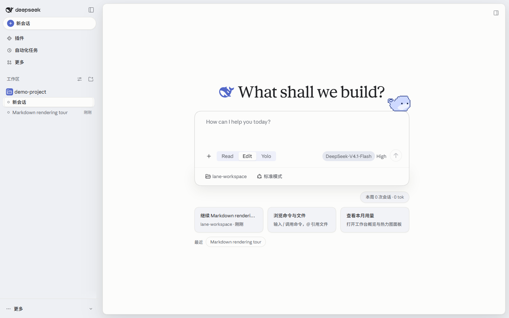</td>
    <td align="center" width="50%">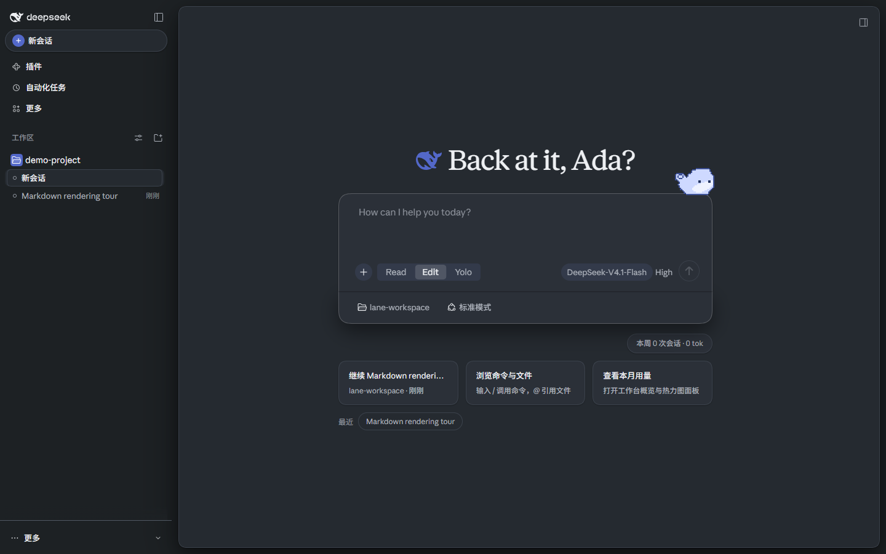</td>
  </tr>
  <tr>
    <td align="center" width="50%">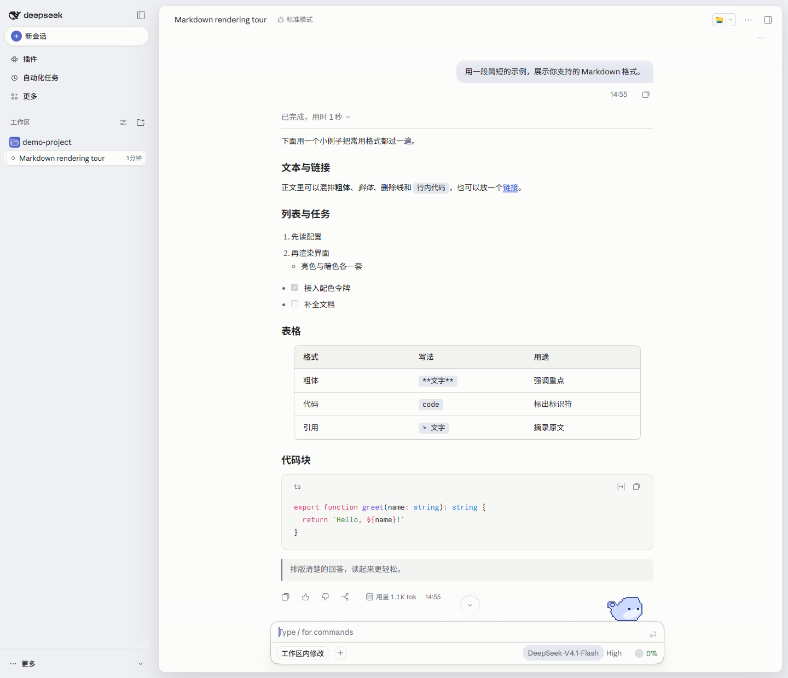</td>
    <td align="center" width="50%">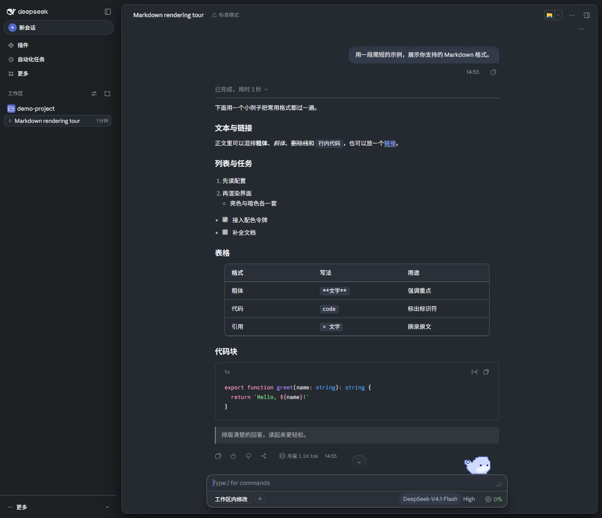</td>
  </tr>
</table>

### Warm ember

<table>
  <tr>
    <td align="center" width="50%">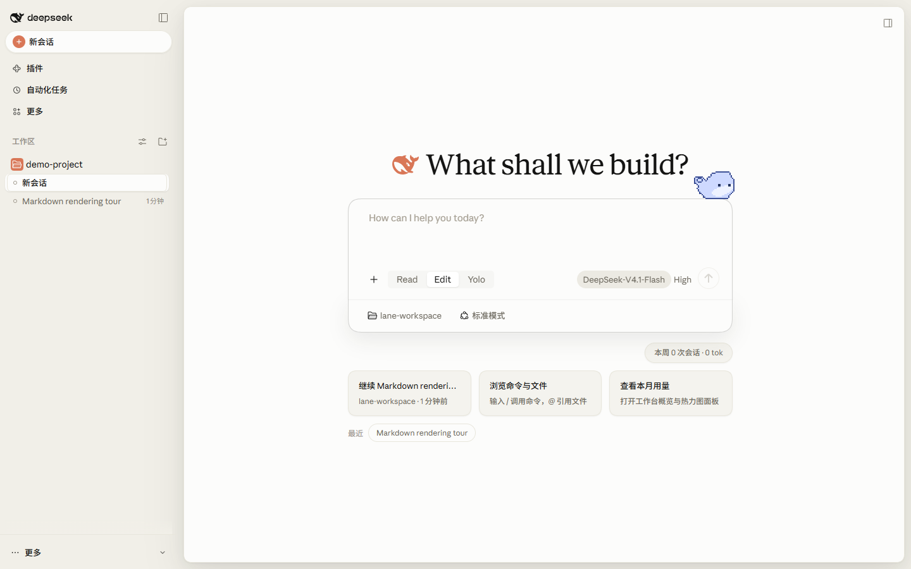</td>
    <td align="center" width="50%">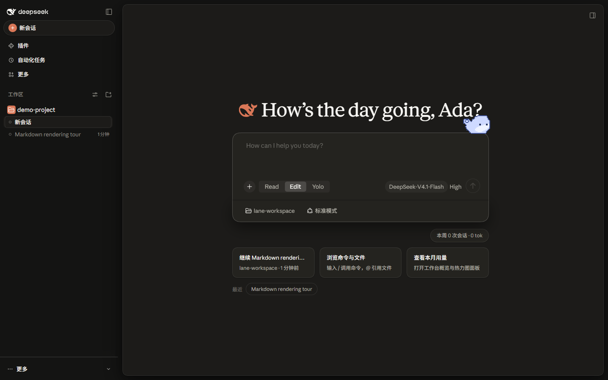</td>
  </tr>
  <tr>
    <td align="center" width="50%">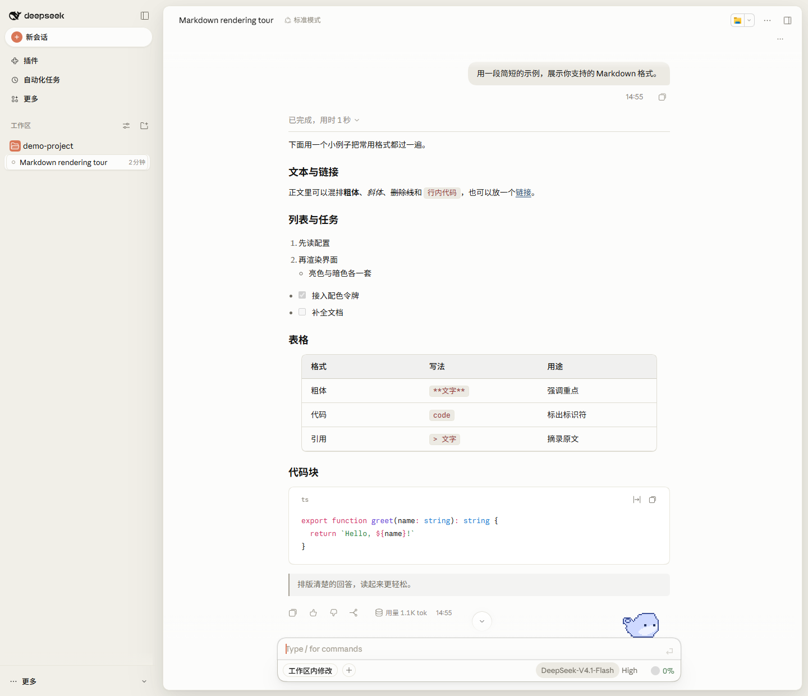</td>
    <td align="center" width="50%">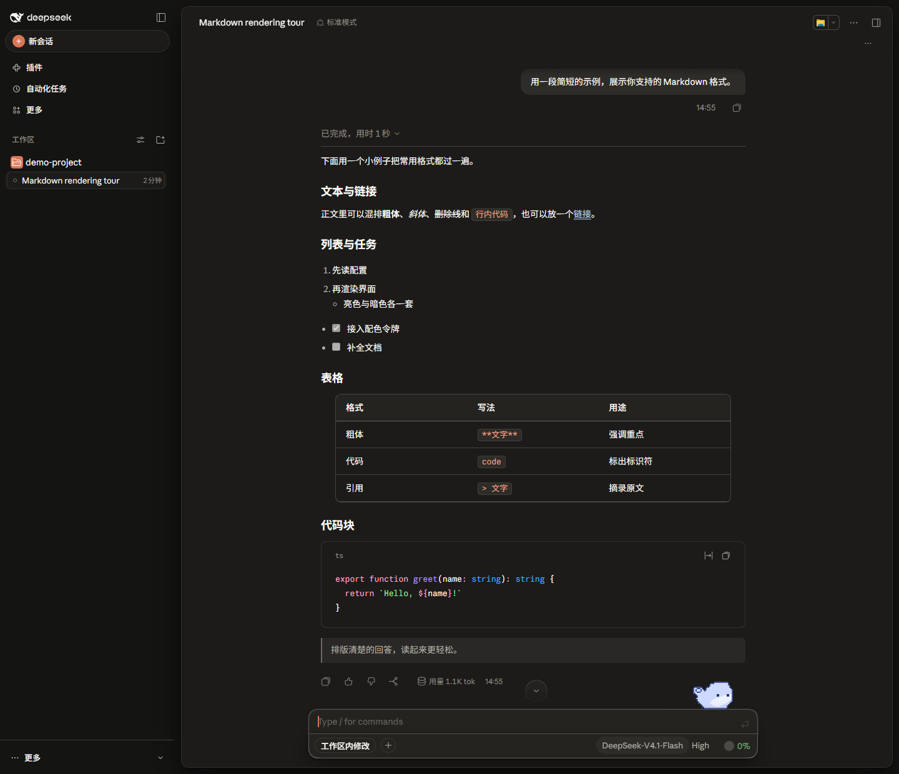</td>
  </tr>
</table>

### Forest green

<table>
  <tr>
    <td align="center" width="50%">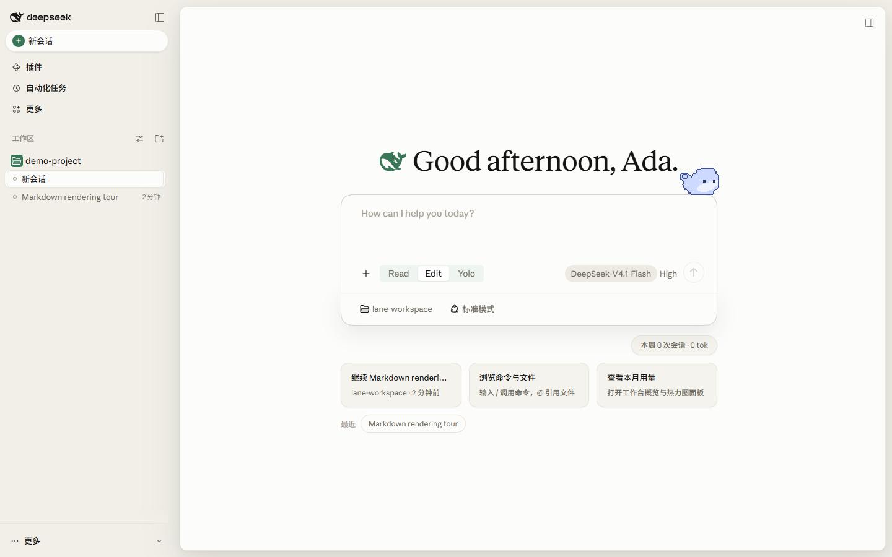</td>
    <td align="center" width="50%">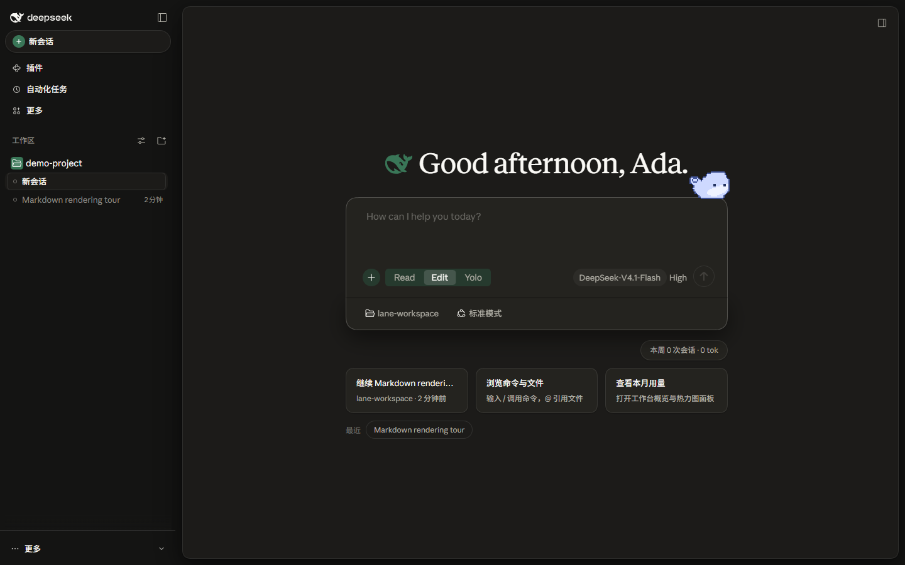</td>
  </tr>
  <tr>
    <td align="center" width="50%">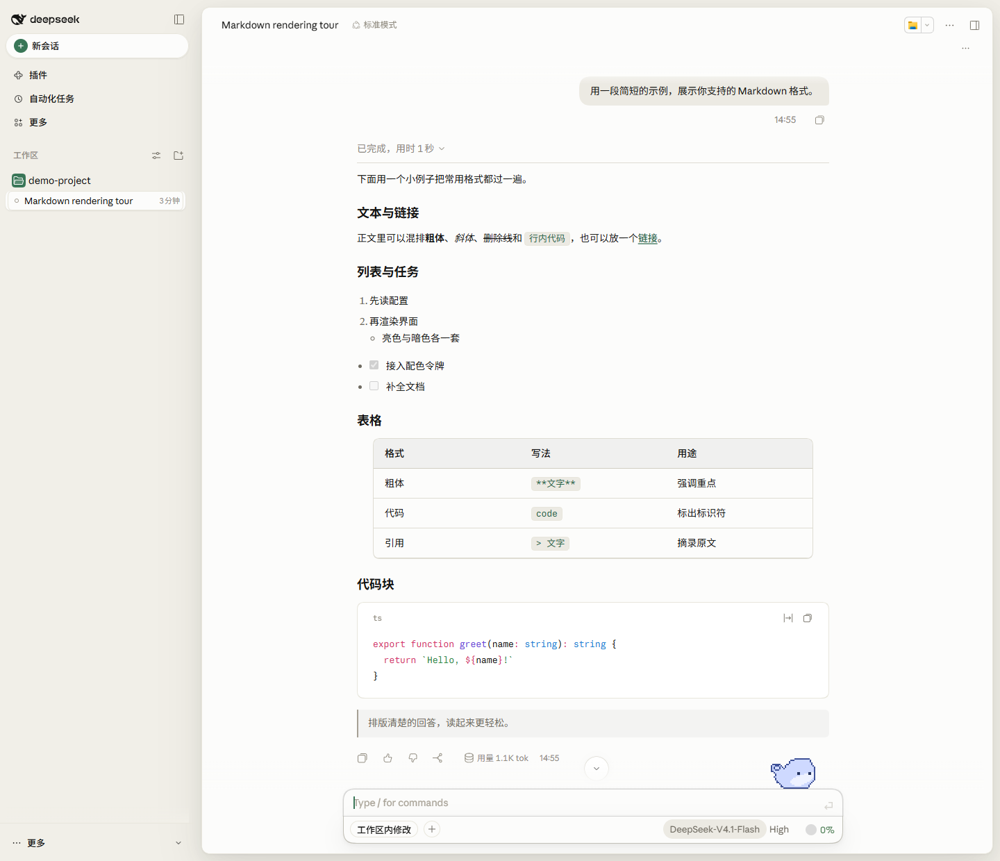</td>
    <td align="center" width="50%">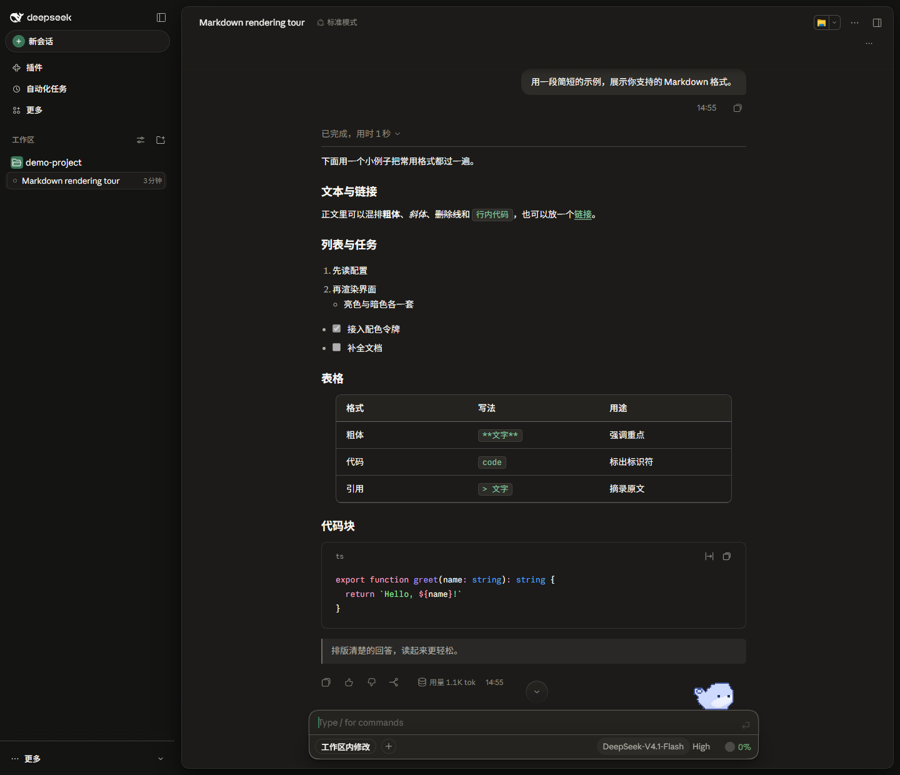</td>
  </tr>
</table>

> Home above, Markdown conversation below; light on the left, dark on the right.

### Layout

- The plugin changes colours and typefaces alone: the conversation's reading column and composer, the home's hero page, the conversation header and view tabs, the sidebar's search and account rows, and the tool-call rows are drawn and operated by the host; the plugin neither moves, redraws nor rewrites them.
- The sidebar gathers every pinned conversation above the workspaces, most recently pinned first; each row names its workspace and opens, renames, unpins or archives through the host's own session menu, while the host's row stays in its workspace.
- The very top of the sidebar is "Last 24 hours": the conversations touched today, newest first, ten at most, leaving the host's own list and the pinned block untouched. Each row can delete its conversation: the trash asks first, then removes the stored record on this device; a conversation the host still holds open is refused, and the card says to close it.

### Pets

- The pet standing on the input area is one choice, changed by neither palette nor brand: Whaledou by default, or another character from the Petdex library through "Chat pet package", or off — and it can be kept to the home page.
- "Chat pet package" in the settings page takes a complete package — a folder, a ZIP or a Petdex link holding `pet.json` and an atlas — keeping the original bytes. The pet art belongs to Petdex and each package's author and is not shipped with this plugin.

### Subagent models

After enabling the host's subagent model selection and creating a session, the concentric-circle icon beside the model control on the composer opens the subagent route panel. The panel names each route in full and can pick one or several routes for the session; each picked route can also carry its own reasoning effort, which later subagent calls then pass along.

## Installation

`lib/` is build output and does not travel with the sources; the packaged release lives on the `dist` branch, so the address names that branch, or build the source checkout first:

```bash
dsh plugin --profile desktop add https://github.com/Zestful-ss/dsh-deepcraft#dist   # the built release branch
dsh plugin --profile desktop add <local path>                                       # source checkout, after npm install && npm run build
```

Keep one theme enabled at a time, and restart DeepSeek Harness afterwards. When the original `dsh-claude-style` is still installed, disable it in the plugin manager.

## Fonts

Appearance offers separate interface, prose and code font choices: Inter, Geist Sans, Fixel Text, Atkinson Hyperlegible, Noto Serif, Source Serif 4, Literata, JetBrains Mono, Geist Mono, Fira Code and Commit Mono, plus a custom list of installed family names for each role. Sizes, weights and line heights stay the host's.

> The Anthropic fonts have no public release; this repository only offers [copies](https://github.com/Zestful-ss/dsh-deepcraft/tree/master/packages/assets/src/fonts/anthropic) for download and study.

To enable them, install the `.ttf` files on your system, or copy them into `$DSH_HOME/dsh-deepcraft/fonts/`.

## Documentation

| Document | Contents |
| --- | --- |
| [Design tokens](docs/STYLE.md) | The palette, typography, shape, motion and layer rules |
| [Architecture decisions](docs/adr/README.md) | One page per direction: background, decision, consequences, revisiting conditions |
| [Changelog](CHANGELOG.md) | Version history |
| [Contributing](CONTRIBUTING.md) | Building from `packages/client/src/`, commit conventions, and the screenshot and regression tooling |

## Related projects

> Running several themes at once? Try [dsh-skin-manager](https://github.com/xiaoyangcheng84-svg/dsh-skin-manager) — it switches between all installed themes from a single settings page.

> Want to import your Claude Code / Codex session history into DSH and keep the conversation going? Try the author's other plugin, [dsh-chat-import](https://github.com/Nwflower/dsh-chat-import).

## Star History

[](https://star-history.com/#Zestful-ss/dsh-deepcraft&Date)
