<div align="center">

# DeepCraft

**为 DeepSeek Harness 提供可自定义品牌、多套配色与字体的外观插件。**

> **默认深海蓝，另有暖橙与森林绿；标志、名称、强调色与宠物都可以换成你自己的。**

[](README.md) [](README.en.md)

[](https://github.com/Zestful-ss/dsh-deepcraft)
[](LICENSE)

</div>

## 预览

四套配色在插件设置里切换，亮暗跟随系统。深海蓝、暖橙与森林绿只换颜色；Cindy 暖象牙还带 12px 圆角、零阴影、克制的动效与侧栏玻璃。切换不改标志、名称与宠物；外观页还可以换上自己的标志、文字标志、强调色、宠物与壁纸——图片或视频铺在整页底层，可见度、模糊与播放方式可调。

### 深海蓝（默认）

<table>
  <tr>
    <td align="center" width="50%">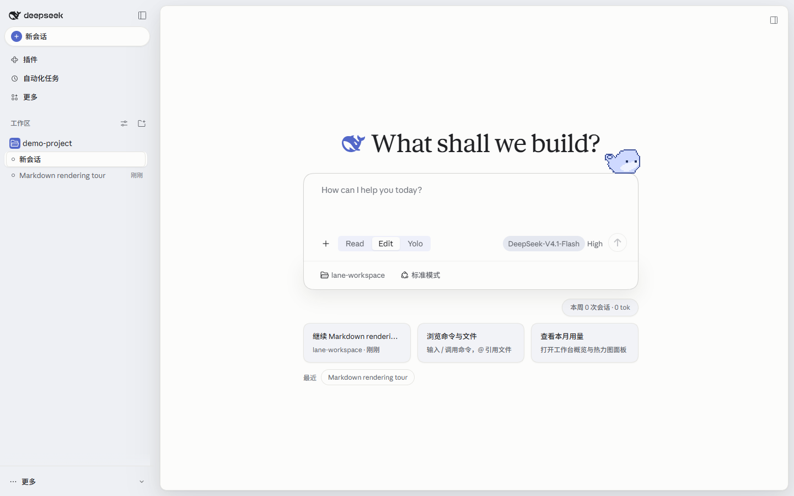</td>
    <td align="center" width="50%">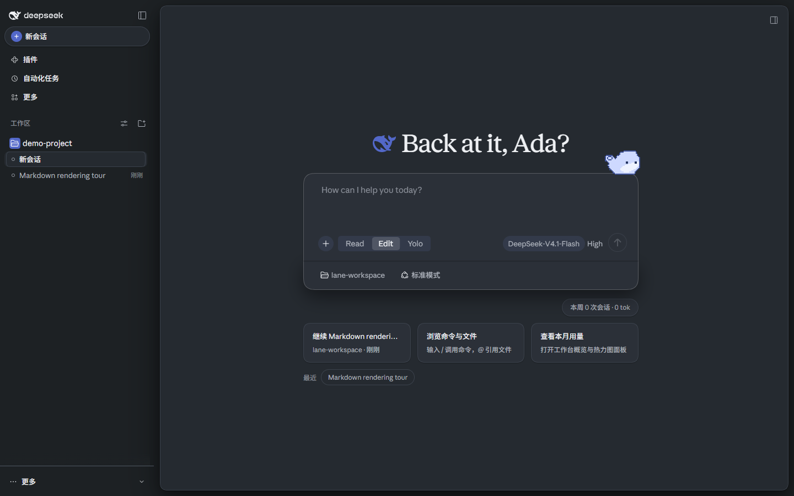</td>
  </tr>
  <tr>
    <td align="center" width="50%">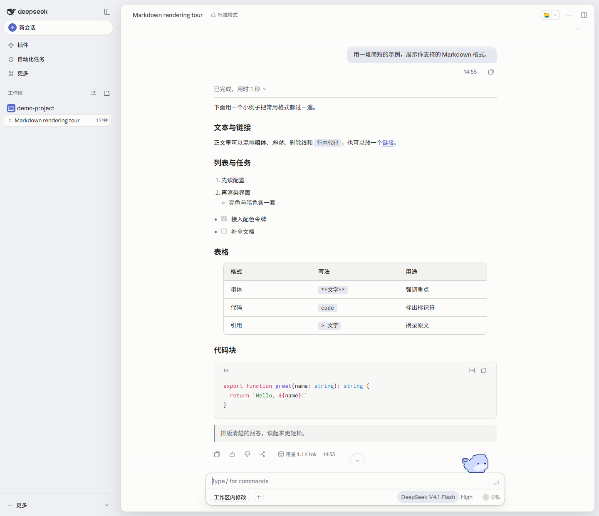</td>
    <td align="center" width="50%">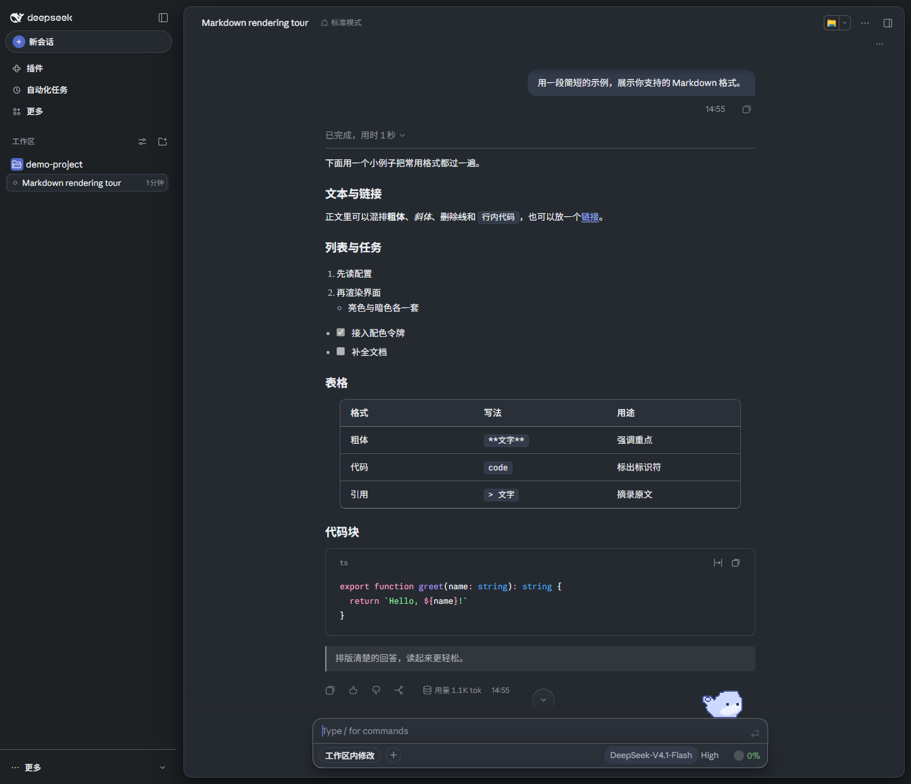</td>
  </tr>
</table>

### 暖橙

<table>
  <tr>
    <td align="center" width="50%">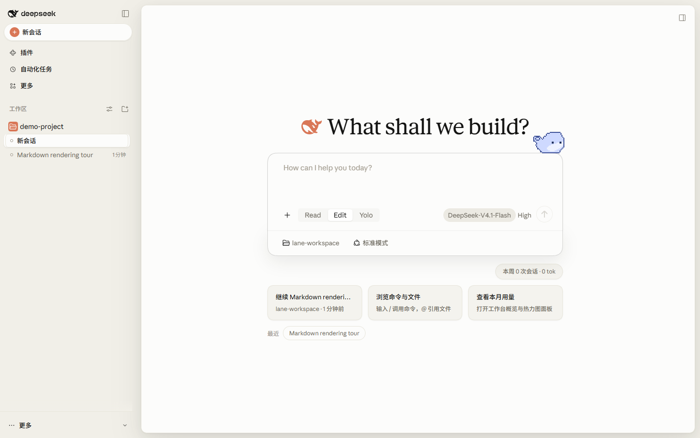</td>
    <td align="center" width="50%">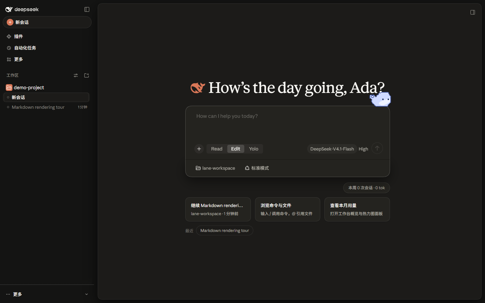</td>
  </tr>
  <tr>
    <td align="center" width="50%">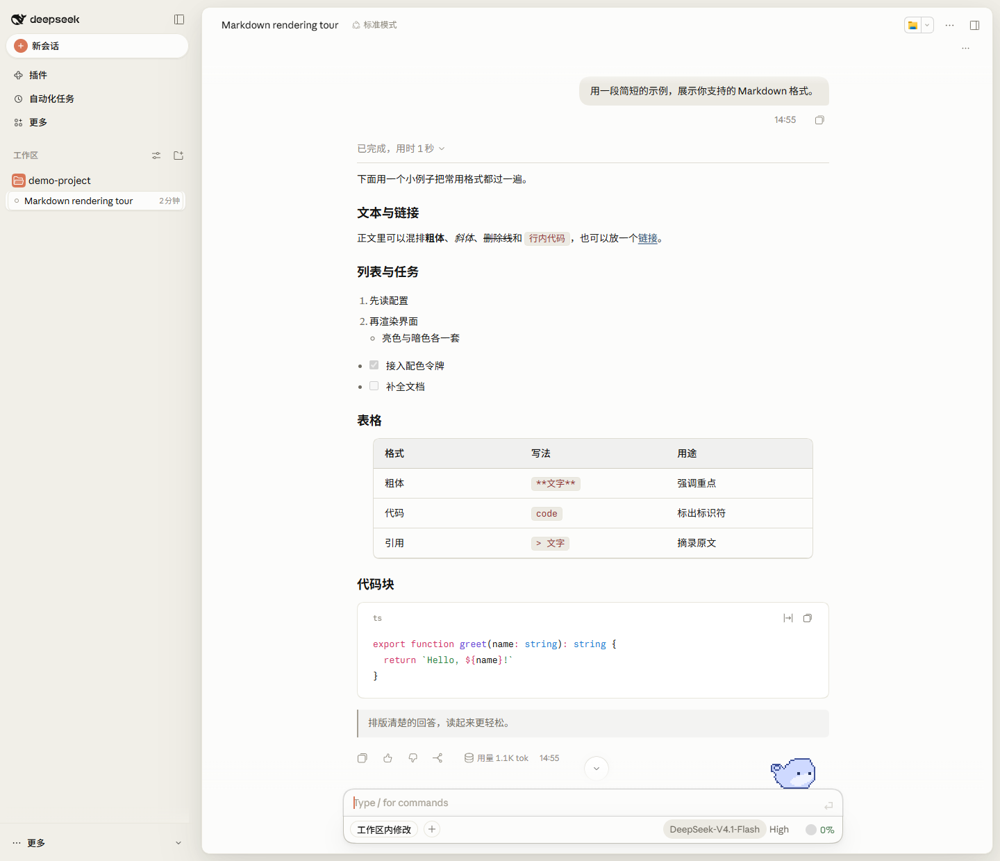</td>
    <td align="center" width="50%">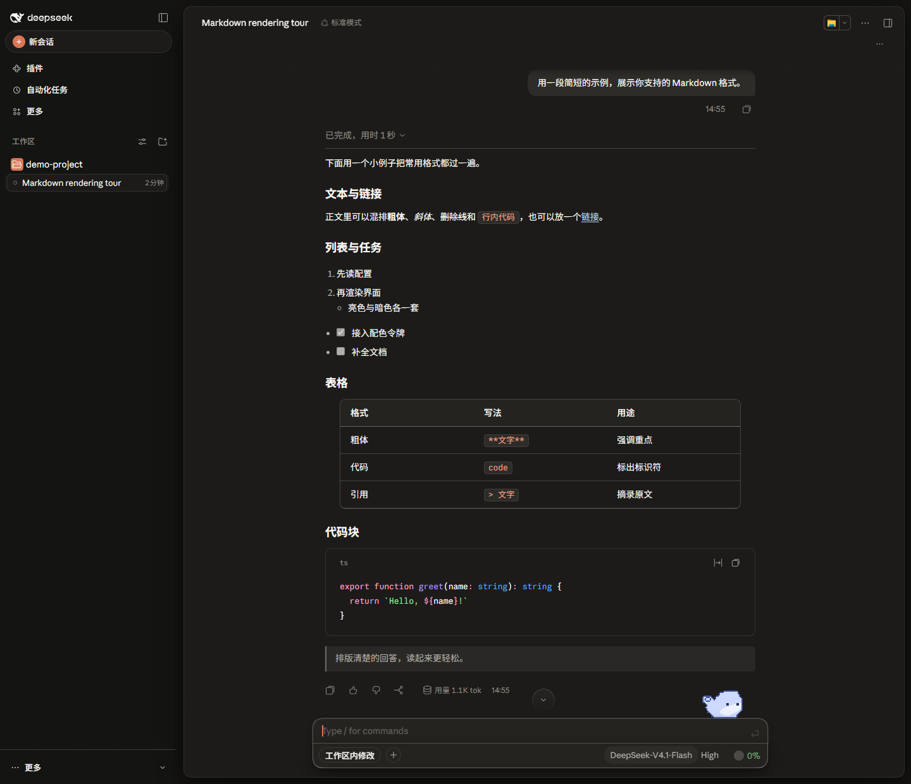</td>
  </tr>
</table>

### 森林绿

<table>
  <tr>
    <td align="center" width="50%">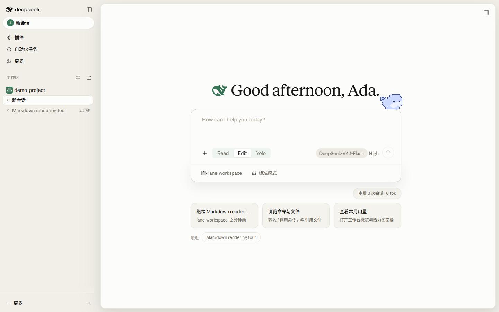</td>
    <td align="center" width="50%">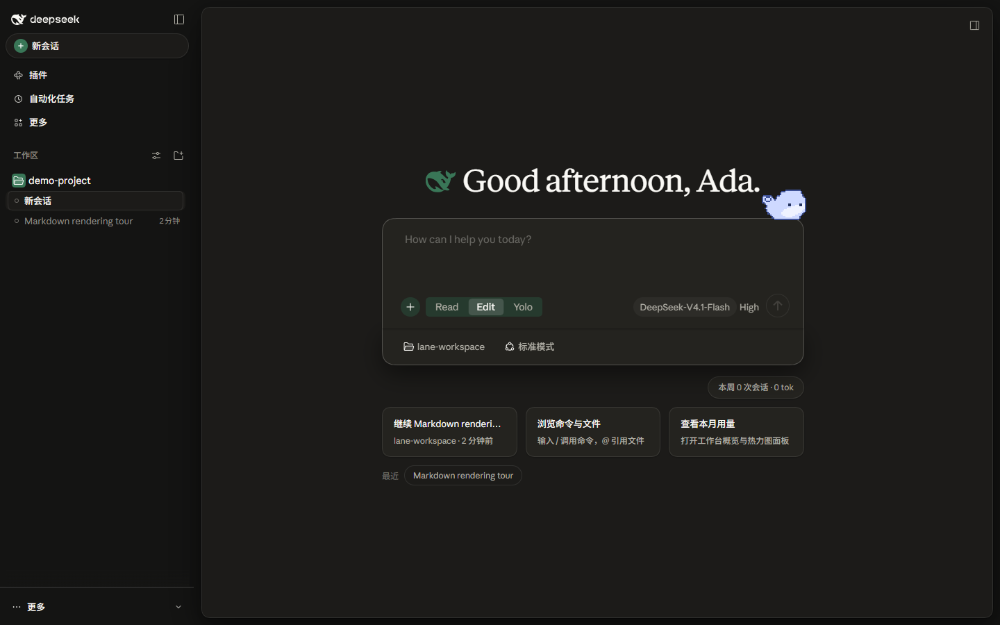</td>
  </tr>
  <tr>
    <td align="center" width="50%">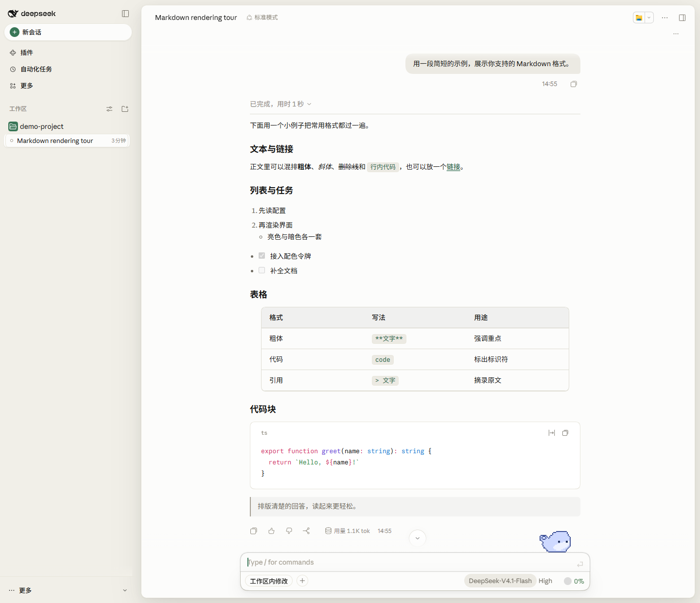</td>
    <td align="center" width="50%">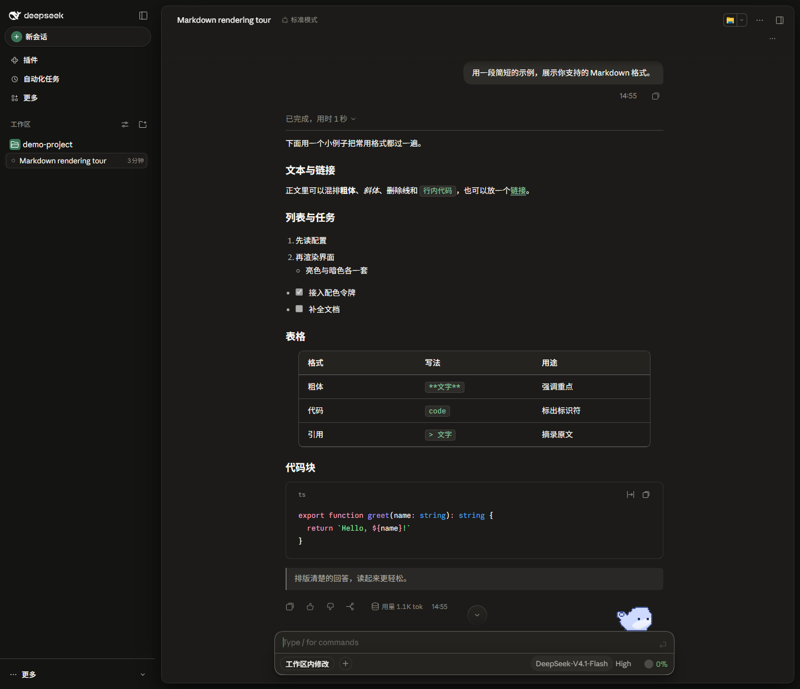</td>
  </tr>
</table>

> 首页（上），对话界面（下）；浅色在左，深色在右。

### 版面

- 插件只改颜色与字体：对话页的阅读栏与输入框、首页的欢迎页、对话页眉与视图标签、侧栏的搜索与账号行，以及工具调用行都由宿主自己绘制和操作，插件不移动、不重绘也不改写它们。
- 侧栏把已置顶会话汇总在所有工作区上方，按最近置顶的顺序列出；行内写明所属工作区，并用宿主自己的会话菜单打开、重命名、取消置顶或归档，工作区里的原行仍保留在原位。

### 宠物

- 输入区上的宠物只有一项选择，不随配色或标识变化：默认 Whaledou，也可以从「聊天框宠物包」换成 Petdex 宠物库里的其他角色，或关闭；可设成只出现在首页。
- 设置页的「聊天框宠物包」接受包含 `pet.json` 与图集的文件夹、ZIP 或 Petdex 链接，原文件字节不改动。宠物原画由 Petdex 与各包作者提供，不随本插件发布。

### 子代理模型

启用官方「允许 Agent 为子智能体选择模型」并创建会话后，输入框右侧模型控件旁的同心圆图标打开子代理路由面板。面板显示完整的路由名称，可以为当前会话选一条或多条路由；已选的路由还能各自设思考强度，后续子代理调用会带上同一档位。

## 安装

`lib/` 是构建产物，不随源码提交；发版时打包好的产物放在 `dist` 分支，安装地址写明该分支，或构建本地源码后再加入：

```bash
dsh plugin --profile desktop add https://github.com/Zestful-ss/dsh-deepcraft#dist   # 已构建的发布分支
dsh plugin --profile desktop add <本地目录>                                          # 本地源码，先 npm install && npm run build
```

同一时刻只启用一个主题，装好后重启 DeepSeek Harness。原版 `dsh-claude-style` 仍在时，在插件管理里停用它。

## 字体

外观页把界面字体、正文字体与代码字体分开选择；内置 Inter、Geist Sans、Fixel Text、Atkinson Hyperlegible、Noto Serif、Source Serif 4、Literata、JetBrains Mono、Geist Mono、Fira Code 与 Commit Mono，每个角色也可以用本机已安装的字体名自定义。字号、字重与行高仍由宿主决定。

> Anthropic 没有公开发行这三款字体；本仓库只提供下载与研究的[副本](https://github.com/Zestful-ss/dsh-deepcraft/tree/master/packages/assets/src/fonts/anthropic)。


启用时二选一：装进系统，或把 `.ttf` 复制到 `$DSH_HOME/dsh-deepcraft/fonts/`。

## 文档

| 文档 | 说明 |
| --- | --- |
| [设计令牌](docs/STYLE.md) | 配色、字体、形状、动效与层级 |
| [架构决策](docs/adr/README.md) | 每条方向一页：背景、决定、后果与重审条件 |
| [更新日志](CHANGELOG.md) | 版本历史 |
| [贡献指南](CONTRIBUTING.md) | 构建、提交规范与回归工具 |

## 友链

> 想把 Claude Code / Codex 等外部代理的会话历史导入 DSH 接着聊？推荐作者的另一个插件 [dsh-chat-import](https://github.com/Nwflower/dsh-chat-import)。

## Star History

[](https://star-history.com/#Zestful-ss/dsh-deepcraft&Date)
